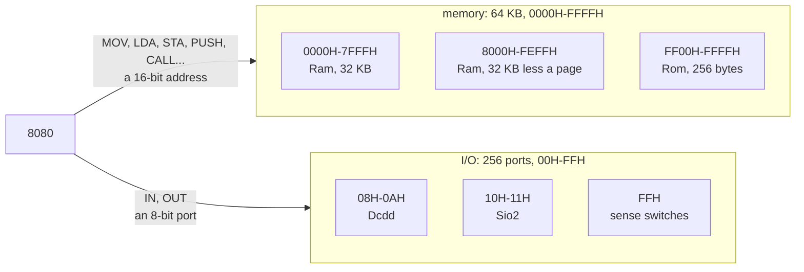

# Memory and I/O ports

The 8080 reaches the cards through two address spaces: 64 KB of memory and
a set of 256 I/O ports. The instruction picks the space. `LDA 0008H` reads
memory at address 0008H, and `IN 08H` reads port 08H, a different place on
a different card.



## Memory

A 16-bit address gives 65,536 bytes, from 0000H to FFFFH. The high byte of
an address names a page of 256 bytes: FF00H to FFFFH make up page FFH, the
top page.

`app` plugs in two RAM cards. When you boot from a disk, a PROM card with
the disk boot loader takes the top page, and the second RAM card stops
below it:

```text
         image, tape                     disk
0000H  ┌──────────────────────┐        ┌──────────────────────┐
       │ Ram, 32 KB           │        │ Ram, 32 KB           │
7FFFH  ├──────────────────────┤        ├──────────────────────┤
8000H  │ Ram, 32 KB           │        │ Ram, 32 KB less      │
       │                      │        │ a page               │
FEFFH  │                      │        ├──────────────────────┤
FF00H  │                      │        │ Rom, 256 bytes: DBL  │
FFFFH  └──────────────────────┘        └──────────────────────┘
```

| Card | Addresses     | Size         | Holds                       |
|------|---------------|--------------|-----------------------------|
| Ram  | `0000H-7FFFH` | 32 KB        | programs and data           |
| Ram  | `8000H-FFFFH` | 32 KB        | programs and data           |
| Ram  | `8000H-FEFFH` | 32,512 bytes | the same, when a PROM is in |
| Rom  | `FF00H-FFFFH` | 256 bytes    | the disk boot loader (DBL)  |

DBL fills the 256 bytes of the PROM, and MITS built it for FF00H: its first
instruction, `LXI H,FF13H`, points into that page. `app/src/machine.rs`
names each range: `LOW_RAM`, `HIGH_RAM`, `HIGH_RAM_BELOW_PROM` and
`PROM_ADDRESS`. `PROGRAM_ADDRESS`, 0000H, is where `app` toggles in an image
or a bootstrap loader and starts the CPU.

### Why the PROM sits at the top

The bottom of memory has to be RAM, because programs write there:

- DBL loads the cold boot loader from the disk at 0000H.
- CP/M keeps page zero, 0000H to 00FFH, for itself: a jump to the BIOS
  at 0000H, the IOBYTE at 0003H and the BDOS entry at 0005H. It runs your
  programs from 0100H.
- The BASIC bootstrap loader and `hello.bin` start at 0000H too.

A PROM there would ignore those writes. At the top it stays out of the
way, and you pay with one step on the front panel: after RESET the CPU
sits at 0000H, so you examine FF00H before you press RUN.

The CPU reaches memory on every instruction: it fetches the opcode from
`PC`. Some instructions also read or write data there: `MOV` with `M`,
`LDA` and `STA`, `PUSH` and `POP`, `CALL` and `RET`. A read from an
address that no card claims returns `FFH`.

## I/O ports

`IN` and `OUT` carry the port number in their second byte, so the 8080 has
a port for each value of a byte, 00H to FFH. A card claims the ports it
answers:

| Port  | Card            | `IN`                                   | `OUT`                                 |
|-------|-----------------|----------------------------------------|---------------------------------------|
| `08H` | Dcdd            | the drive status                       | selects a drive                       |
| `09H` | Dcdd            | the sector under the head              | a command: step, load the head, write |
| `0AH` | Dcdd            | the next byte from the disk            | the next byte to the disk             |
| `10H` | Sio2            | the status: a key waits, ready to send | a control byte                        |
| `11H` | Sio2            | the key you typed                      | a character for the screen            |
| `FFH` | the front panel | the sense switches A8-A15              | ignored                               |

`IN` from a port that no card claims returns `FFH`, and an `OUT` to it goes
nowhere. The sense switches sit on the front panel, outside the slots, so
the machine answers `IN 0FFH` itself. [front-panel.md](front-panel.md)
explains them.

A port can return a new byte on each read. `IN 0AH` gives the next byte of
the sector each time, as reading a file does, while a memory address
returns the same byte until a program writes it.

## How a card tells memory from a port

On the real S-100 bus, the CPU puts the address or the port number on the
same address lines. Status lines say which space it means: `sMEMR` for a
memory read, `sINP` for `IN`, `sOUT` for `OUT`. A memory card ignores a
cycle with `sINP` or `sOUT`, so `IN 08H` never reaches the byte at 0008H.

In the code, the two spaces are two traits, and `Card` has a method for
each access:

| The CPU executes      | The bus calls         | Trait       |
|-----------------------|-----------------------|-------------|
| a fetch, `LDA`, `MOV` | `read(addr)`          | `MemoryBus` |
| `STA`, `MOV M,r`      | `write(addr, value)`  | `MemoryBus` |
| `IN port`             | `input(port)`         | `IoBus`     |
| `OUT port`            | `output(port, value)` | `IoBus`     |

A `Ram` implements `read` and `write`, a `Sio2` implements `input` and
`output`, and the `Backplane` passes each call to every card. The card that
claims the address or port answers.

## Two 256s

The PROM holds 256 bytes, and the 8080 has 256 ports. The numbers match by
chance. The 8080 counts ports with one byte, so it has 256 of them. MITS
fit DBL into one page of memory, and a page holds 256 bytes. A port takes
no memory: the RAM below FF00H stays whole with or without the 88-DCDD.
