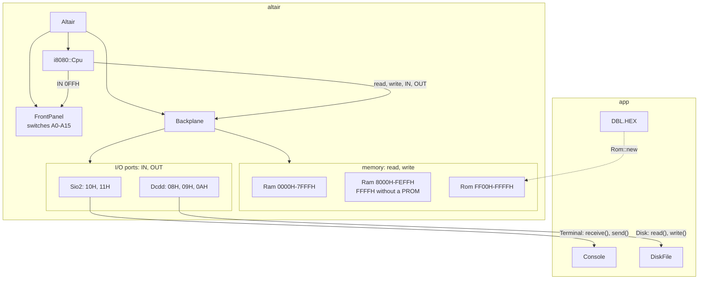
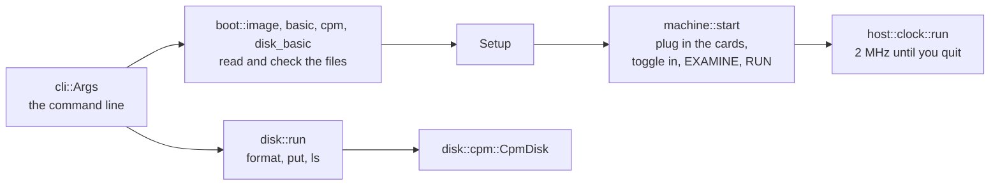
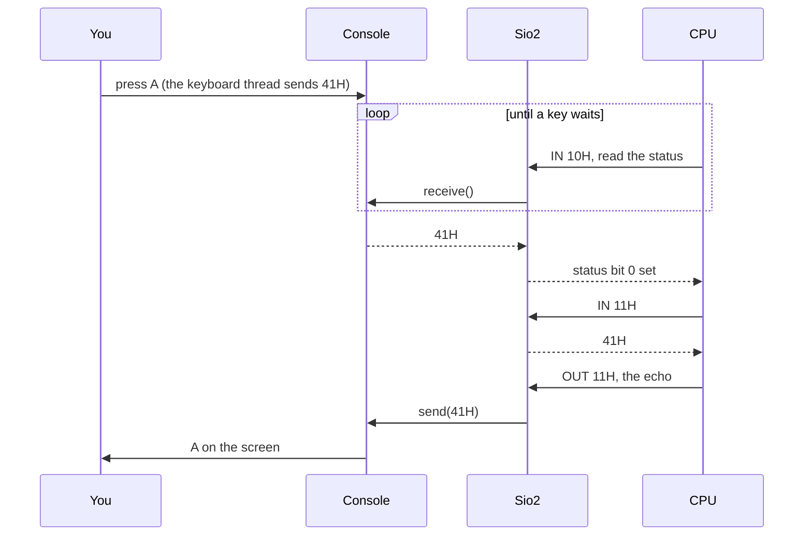

# Architecture

Read this before you change code. It shows the layers of the emulator, the
rules between them and where each part lives. The code documents the
details: run `cargo doc --open`.

## The big picture

The emulator splits the way the real computer does: a processor, the machine
around it, and you at the terminal.

```
                ┌──────────────────────────┐
                │ app                      │  your terminal, files,
                └────────────┬─────────────┘  command line
                             │
                ┌────────────┴─────────────┐
                │ altair                   │  the cards, the backplane,
                └────────────┬─────────────┘  the front panel
                             │
                ┌────────────┴─────────────┐
                │ i8080                    │  the processor
                └──────────────────────────┘
```

| Crate    | Plays the role of             | Depends on                    | Touches the host |
|----------|-------------------------------|-------------------------------|------------------|
| `i8080`  | the Intel 8080 processor      | nothing                       | no               |
| `altair` | the MITS Altair 8800 computer | `i8080`                       | no               |
| `app`    | you, sitting at the terminal  | `altair`, `clap`, `crossterm` | yes              |

A crate depends on the crates below it and never on one above. The compiler
enforces this: `i8080/Cargo.toml` lists no dependencies, so `i8080` can't
reach `altair`. The libraries live in `crates/`, and `app` sits at the root
of the repository.

### Three rules

1. **The processor knows nothing about the machine.** The CPU reaches memory
   and ports through two traits, `MemoryBus` and `IoBus`. A machine
   implements both, and `i8080` stays as it is.
2. **We emulate hardware and run original software.** `altair` copies the
   Altair's circuits. Altair BASIC runs from its original paper tape and
   CP/M from its original disk image, byte for byte. The tests bend this rule once:
   `crates/i8080/tests/diagnostics.rs` fakes two CP/M system calls, so the
   CPU diagnostics run without a machine.
3. **Libraries do no I/O.** `i8080` and `altair` never open a file, read the
   keyboard or print. `app` does all of that, and tests run the libraries
   without a terminal.

## Inside altair



You plug cards into the backplane with `Altair::builder()`, as an Altair
owner did. The backplane passes each memory access, `IN` and `OUT` to every
card, and the card that claims the address or port answers, as on the real
bus. The front panel sits outside the slots and answers `IN 0FFH` with the
sense switches.

Two cards reach outside the Altair, each through a trait that `app`
implements:

| Card   | Trait      | Methods                                             | `app` implements it with |
|--------|------------|-----------------------------------------------------|--------------------------|
| `Sio2` | `Terminal` | `receive` returns the next key, `send` shows a byte | `Console`                |
| `Dcdd` | `Disk`     | `read` and `write` a byte at an offset in the image | `DiskFile`               |

To add hardware, you write a card and plug it in. The CPU and the other
cards stay as they are.

[front-panel.md](altair/front-panel.md) explains the switches, and
[memory-and-ports.md](altair/memory-and-ports.md) maps the memory and the
I/O ports.

## Inside app

`app` is the `altair` command: a library with the code, and a `main.rs`
that calls `app::run`. The split lets `cargo test` run the examples in the
documentation.



Each way to boot fills one struct with what the owner brought, and checks
the files before your terminal switches to raw mode. `machine::start` reads
it top to bottom, with no match on the way you boot:

```rust
pub struct Setup {
    pub toggle_in: Option<Program>, // the image or the bootstrap loader
    pub prom: Option<Program>,      // DBL at FF00H
    pub disks: Vec<DiskFile>,       // physical drives 0 and up
    pub tape: Vec<u8>,              // the paper tape in the reader
    pub start: u16,                 // where RUN starts the CPU
    pub sense_switches: u8,
    pub erase_key: u8,              // what Backspace sends
}
```

| Module             | What it holds                                              |
|--------------------|------------------------------------------------------------|
| `lib`              | `run`, the flow above                                      |
| `cli`              | the command line: `Args`, `Command`, `DiskCommand`         |
| `boot`             | `Setup` and `Program`                                      |
| `boot::image`      | `setup` for a memory image                                 |
| `boot::basic`      | `setup` for a tape, `Basic` and the MITS bootstrap loaders |
| `boot::cpm`        | `setup` for CP/M disks                                     |
| `boot::disk_basic` | `setup` for Disk BASIC, including its sense switches       |
| `boot::floppy`     | the shared PROM and disk file setup for both disk boots    |
| `boot::hex`        | the Intel HEX reader for DBL                               |
| `machine`          | `start`: the cards and the front panel steps               |
| `disk`             | `altair disk`: `format`, `put` and `ls`                    |
| `disk::cpm`        | `CpmDisk`, the CP/M file system on a disk image            |
| `host::console`    | `RawMode` and `Console`, your side of the serial line      |
| `host::clock`      | the 2 MHz clock, `Speed` and `Exit`                        |
| `host::disk_file`  | `DiskFile`, a disk image file in a drive                   |

## A key press, through every layer



The key crosses all three layers: `app` reads it from your terminal,
`altair` holds it in the serial card, and the 8080 in `i8080` fetches it
with `IN`. BASIC polls the status port in a loop, and each status read asks
the `Console` for a key. Once a key arrives, the card holds it and sets bit 0.
BASIC reads the key from port `11H` and writes it back, so you see what you
typed.

With receive IRQ enabled, `Altair::step` checks the terminal between CPU
instructions through `Card::interrupt_pending`. The backplane samples all
cards and combines their requests on PINT. `Altair` delivers the open-bus
`RST 7` to `Cpu::interrupt`. A handler reads the byte with `IN 11H`.
[memory-and-ports.md](altair/memory-and-ports.md#serial-interrupts) lists
the control bytes and the limits of the serial emulation.

## Decisions in the CPU core

- **One bus for both address spaces.** `step` borrows a bus that implements
  `MemoryBus` and `IoBus` for one instruction and keeps nothing, like the
  shared pins of the real chip. We need no shared ownership (`Rc<RefCell<…>>`), and Rust resolves each bus call at compile time.
  Tests that keep memory and ports apart join them with `Bus { memory, io }`.
- **Decode, then execute.** `step` turns the bytes at `PC` into an
  `Instruction` value and then executes it. Decoding reads bytes and nothing
  else, so a disassembler can reuse it.
- **One line per instruction.** The `match` in `execute`, shared by `step`
  and `interrupt`, dispatches each
  instruction to a method named after it (`mvi`, `mov`), which does the work
  and returns the cycle count.
- **Decoding can't fail.** The 8080 runs all 256 opcodes. The 12
  undocumented ones copy documented ones: `08H` acts as `NOP`, `CBH` as
  `JMP`. `step` returns no `Result`.
- **Each step reports clock cycles.** `app` needs them to keep the Altair's
  speed. A conditional `CALL` or `RET` takes longer when the condition holds,
  so the count depends on the flags.

[instructions.md](i8080/instructions.md) describes each instruction.
