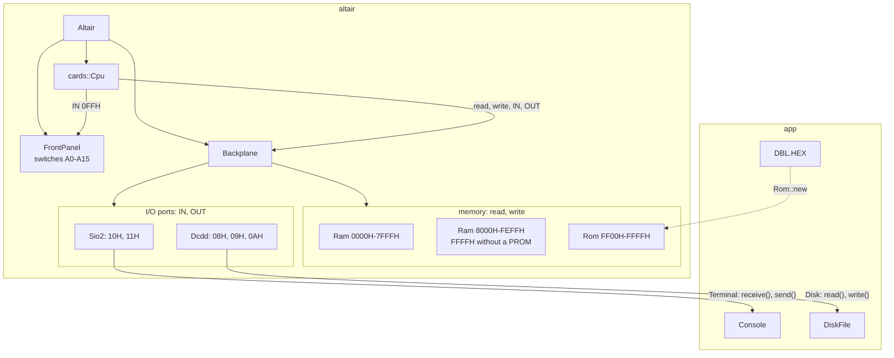
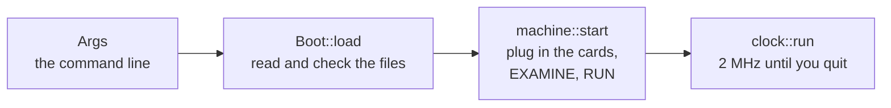
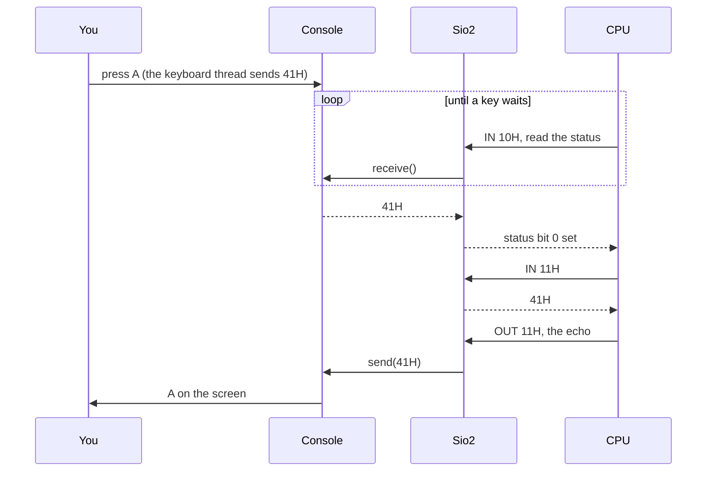
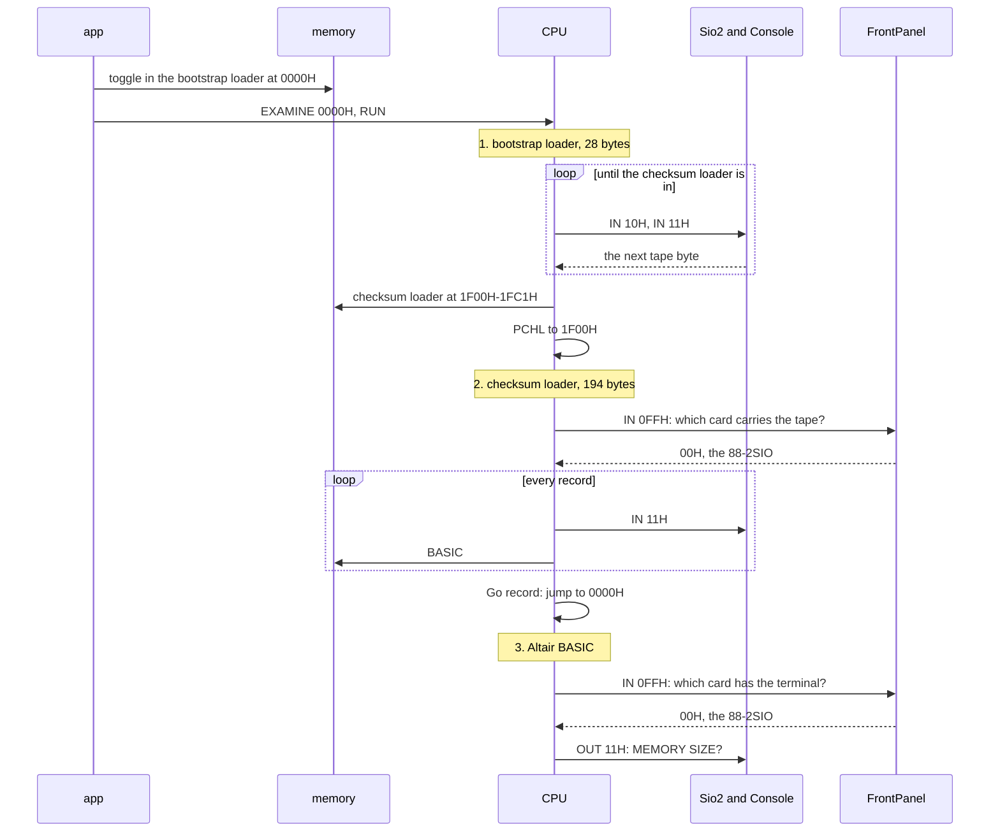
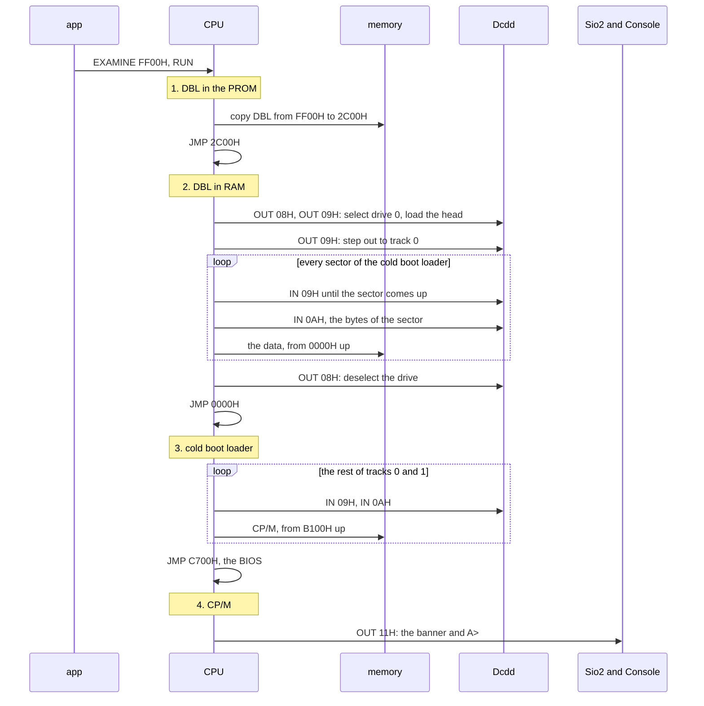

# Architecture

Read this before you change code. It shows the layers of the emulator and
the reasons behind them.

## The big picture

The emulator splits the way the real computer does: a processor, the machine
around it, and you at the terminal.

```
                ┌──────────────────────────┐
                │ app                      │  your terminal, files,
                └────────────┬─────────────┘  command line
                             │
                ┌────────────┴─────────────┐
                │ altair                   │  the cards, the backplane,
                └────────────┬─────────────┘  the front panel
                             │
                ┌────────────┴─────────────┐
                │ i8080                    │  the processor
                └──────────────────────────┘
```

| Crate    | Plays the role of             | Depends on                    | Touches the host |
|----------|-------------------------------|-------------------------------|------------------|
| `i8080`  | the Intel 8080 processor      | nothing                       | no               |
| `altair` | the MITS Altair 8800 computer | `i8080`                       | no               |
| `app`    | you, sitting at the terminal  | `altair`, `clap`, `crossterm` | yes              |

A crate depends on the crates below it and never on one above. The compiler
enforces this: `i8080/Cargo.toml` lists no dependencies, so `i8080` can't
reach `altair`. The libraries live in `crates/`, and `app` sits at the root
of the repository.

### Three rules

1. **The processor knows nothing about the machine.** The CPU reaches memory
   and ports through two traits, `MemoryBus` and `IoBus`. A machine
   implements both, and `i8080` stays as it is.
2. **We emulate hardware and run original software.** `altair` copies the
   Altair's circuits. Altair BASIC runs from its original paper tape and
   CP/M from its original disk image, byte for byte. The tests bend this rule once:
   `crates/i8080/tests/diagnostics.rs` fakes two CP/M system calls, so the
   CPU diagnostics run without a machine.
3. **Libraries do no I/O.** `i8080` and `altair` never open a file, read the
   keyboard or print. `app` does all of that, and tests run the libraries
   without a terminal.

## Inside the Altair



The code follows the box:

| Module    | What it holds                                             |
|-----------|-----------------------------------------------------------|
| `machine` | `Altair` and the chassis: `Backplane`, `FrontPanel`       |
| `cards`   | What you plug in: `Cpu`, `Ram`, `Rom`, `Sio2` and its `Terminal`, `Dcdd` |

You plug in the cards with the builder, as an Altair owner did. This Altair
boots CP/M:

```rust
let mut dcdd = cards::Dcdd::new();
dcdd.insert(0, disk)?;

let mut altair = Altair::builder()
    .plug(cards::Cpu::new())
    .plug(cards::Ram::new(0x0000..=0x7FFF)?)
    .plug(cards::Ram::new(0x8000..=0xFEFF)?)
    .plug(cards::Sio2::new(console))
    .plug(cards::Rom::new(0xFF00, dbl)?)
    .plug(dcdd)
    .build()?;
```

The backplane passes each memory access, `IN` and `OUT` to every card, and
the card that claims the address or port answers, as on the real bus. A read
that no card claims returns `FFH`, like an empty slot. Each card except the
CPU implements the `Card` trait:

| Card       | Claims                       | Plays the role of                       |
|------------|------------------------------|-----------------------------------------|
| `Cpu`      | nothing: it drives the bus   | the 88-CPU card with its 2 MHz clock    |
| `Ram`, two | `0000H-7FFFH`, `8000H-FEFFH` | two memory cards, 64 KB without a PROM  |
| `Rom`      | `FF00H-FFFFH`                | a PROM card with the disk boot loader   |
| `Sio2`     | ports `10H` and `11H`        | the 88-2SIO serial card, port A         |
| `Dcdd`     | ports `08H`, `09H` and `0AH` | the 88-DCDD floppy disk controller      |

The CPU card wraps an `i8080::Cpu`, gives you all of its fields and methods
and adds the clock, `Cpu::CLOCK_HZ`. The machine keeps it apart from the
backplane and lends it the backplane as its bus on each `step`. `build()`
returns an error if you plug in no CPU card or two.

A PROM can't change, so `Rom` ignores writes. The disk turns one sector
each time a program reads port `09H`.

Two cards reach outside the Altair, each through a trait that `app`
implements:

| Card   | Trait      | Methods                                         | `app` implements it with |
|--------|------------|-------------------------------------------------|--------------------------|
| `Sio2` | `Terminal` | `receive` returns the next key, `send` shows a byte | `Console`            |
| `Dcdd` | `Disk`     | `read` and `write` a byte at an offset in the image | `DiskFile`           |

`DiskFile` reads from a copy in memory and writes each byte to the file at
once, as a floppy keeps what the head writes. You lose nothing when the
emulator stops. A `Vec<u8>` implements `Disk` too, for a disk in memory.

To add hardware, you write a card and plug it into the backplane. The CPU and
the other cards stay as they are.

The front panel sits outside the slots, as on the real Altair. You get it
with `altair.front_panel()` and operate it with the real commands. The panel
can't set `PC` itself: EXAMINE feeds the CPU a `JMP` through the data bus,
EXAMINE NEXT a `NOP`, and the CPU executes them. DEPOSIT writes the low byte
of the switches to memory, and RUN lets the CPU go. The upper eight switches
double as the sense switches: the machine answers `IN 0FFH` with them before
the backplane sees the access. [front-panel.md](altair/front-panel.md)
explains every switch, and [memory-and-ports.md](altair/memory-and-ports.md)
maps the memory and the I/O ports.

## Inside app

`app` is the `altair` command. It reads the command line with `clap`, builds
the machine and does what an Altair owner did by hand. A subcommand names
the way you boot:

| Command                         | Cards beyond the CPU, memory and 88-2SIO | `app` does                                                          |
|---------------------------------|------------------------------------------|---------------------------------------------------------------------|
| `altair image FILE`             | none                                     | toggles the image in at 0000H and starts there                      |
| `altair tape 8k-4.0 FILE`       | none                                     | toggles in the bootstrap loader at 0000H and puts the tape in the reader |
| `altair disk LOADER.HEX FILE`   | the PROM at FF00H and the 88-DCDD        | puts the loader into the PROM and the disk into drive 0, starts at FF00H |

`--switches` sets the sense switches with any subcommand. The machine runs
until you press Ctrl+] or the CPU halts.

`main.rs` reads top to bottom in four steps:



`Boot` holds what you bring to the Altair, with the files read and checked:

```rust
pub enum Boot {
    Image(Vec<u8>),
    Tape { basic: Basic, tape: Vec<u8> },
    Disk { loader: Program, disk: Vec<u8> },
}
```

Each variant carries only what it needs, so `machine::start` matches on it
and plugs in the cards for that boot. `Boot::load` stops before the machine
starts if a tape holds another BASIC or the loader sits below FF00H.

| Module         | What it holds                                                  |
|----------------|----------------------------------------------------------------|
| `main`         | `main` and `run`, the four steps above                         |
| `args`         | the command line: `Args` and its `Command`                     |
| `boot`         | `Boot` and `Boot::load`                                        |
| `boot::tape`   | `Basic` and the MITS bootstrap loaders for the BASIC tapes     |
| `boot::hex`    | the Intel HEX reader for the disk boot loader                  |
| `machine`      | the cards for each boot and the front panel steps that start it |
| `clock`        | the 2 MHz clock and `Exit`                                     |
| `console`      | `RawMode` and `Console`, your side of the serial line          |
| `disk_file`    | `DiskFile`, the disk image file in the boot drive              |

- **`RawMode`** switches your terminal to raw mode with `crossterm` and back
  when dropped. Each key then reaches the emulator at once, without an echo:
  Altair BASIC echoes what you type itself.
- **`Console`** implements `Terminal`. A thread reads the keyboard and sends
  each key over a channel, so `receive` never waits. The thread drops bytes
  above 7FH: a Teletype sends 7-bit ASCII, and a Cyrillic letter would reach
  BASIC as junk. It sends Ctrl+H for your Backspace key when you boot from
  a disk, because CP/M and MBASIC erase on it, and leaves the key as RUBOUT
  (7FH) for Altair BASIC. With a tape the console sends the tape first and
  your keys after it, like the tape reader on a Teletype, which shared the
  line with the keyboard.
- **The clock.** Your computer runs the 8080 faster than 2 MHz. So `app`
  runs the CPU for 20,000 cycles, the work of 10 ms on the real Altair, and
  sleeps until those 10 ms are up. Programs keep their original speed, and
  BASIC waiting for a key leaves your CPU idle.

## You press a key, BASIC prints it



BASIC polls the status port in a loop, and each status read asks the
`Console` for a key. Once a key arrives, the card holds it and sets bit 0.
BASIC reads the key from port `11H` and writes it back, so you see what you
typed.

## BASIC loads from a paper tape

An Altair owner loaded BASIC in three programs, each loading the next. The
addresses below are those of 8K BASIC 4.0; the other versions move the
checksum loader to another page.



1. **The bootstrap loader.** The owner toggled these 28 bytes in with the
   front panel switches, and `app` does the same through `FrontPanel`. The
   loader skips the tape's leader, bytes of `C2H`, and stores the next 194 bytes downward
   from 1FC1H. Then it jumps to them.
2. **The checksum loader.** It reads the sense switches to learn which card
   carries the tape, then reads BASIC in records. Each record holds `3CH`, a
   byte count, a load address, the data and a checksum. A bad checksum stops
   the load with a `C`. A Go record, `78H` and an address, ends the tape.
   With the switches at `FFH` the loader finds no card it knows and prints
   `I` again and again.
3. **Altair BASIC.** It reads the switches again to find the terminal and
   asks `MEMORY SIZE?`. The tape has run out, so your keys answer.

Memory at each stage:

```text
               bootstrap        checksum loader    BASIC
               loader runs      runs               runs
0000H-001BH    bootstrap        bootstrap          BASIC
001CH-1EFFH    zeros            BASIC arrives      BASIC, your program
1F00H-1FC1H    zeros            checksum loader    free memory
1FC2H-FFFFH    zeros            zeros              free memory
```

The record for 0000H comes last on the tape, so the bootstrap loader stays in
memory until the rest of BASIC is in. Martin Eberhard describes the loaders
and the tape format in
[Loading Basic with the 88-2SIO Board](https://deramp.com/downloads/mfe_archive/010-S100%20Computers%20and%20Boards/00-MITS/10-MITS%20S100%20Boards/88-2SIO%20Dual%20Serial%20Board/Loading%20Basic%20with%20the%2088-2SIO%20Board.pdf)
and
[Altair Software Development using CP/M](https://deramp.com/downloads/altair/software/papertape_cassette/Checksum%20Loader/Altair%20Paper%20Tape%20Format.pdf).

## CP/M boots from a floppy

CP/M loads in three programs too: the disk boot loader (DBL) in the PROM,
the cold boot loader from the disk, and CP/M itself. The addresses below
are those of the 56 KB CP/M 2.2b.



1. **DBL in the PROM.** `app` examines FF00H and presses RUN. DBL copies
   itself to 2C00H and jumps there. Its source explains why: the EPROM
   answered too slow for the disk.
2. **DBL in RAM.** It selects drive 0, loads the head and steps out to
   track 0. Then it reads sectors and moves their data into memory from 0000H
   up, as many bytes as the count in the sector header says. A bad
   checksum makes DBL read the sector again, and after sixteen tries it
   stops with a `C`. At the end it deselects the drive and jumps to 0000H.
3. **The cold boot loader.** Mike Douglas wrote it for this CP/M. It reads
   the CP/M image from the rest of the two system tracks into high memory
   and jumps to the BIOS.
4. **CP/M.** The BIOS sets up the 88-2SIO, prints the banner and starts the
   CCP, which prints `A>` and waits for your command.

Memory once CP/M runs:

```text
0000H-00FFH    page zero: the cold boot loader during the boot, then
               the jumps to the BIOS and the BDOS
0100H-B0FFH    the TPA, where CP/M runs your program; DBL works at
               2C00H during the boot
B100H-B8FFH    the CCP, the command line
B900H-C6FFH    the BDOS
C700H-DFFFH    the BIOS for the 8-inch floppy
E000H-FEFFH    RAM that this CP/M leaves unused
FF00H-FFFFH    the PROM with DBL
```

DBL comes from [DBL.ASM](https://deramp.com/downloads/altair/software/roms/orginal_roms/DBL.ASM),
which Martin Eberhard disassembled from a MITS EPROM. The cold boot loader
and the memory layout come from
[BOOT.ASM](https://deramp.com/downloads/altair/software/8_inch_floppy/CPM/CPM%202.2/CPM%202.2B/BOOT.ASM)
and
[BIOS.ASM](https://deramp.com/downloads/altair/software/8_inch_floppy/CPM/CPM%202.2/CPM%202.2B/BIOS.ASM)
by Mike Douglas.

## Decisions in the CPU core

- **One bus for both address spaces.** `step` borrows a bus that implements
  `MemoryBus` and `IoBus` for one instruction and keeps nothing, like the
  shared pins of the real chip. We need no shared ownership
  (`Rc<RefCell<…>>`), and Rust resolves each bus call at compile time.
  Tests that keep memory and ports apart join them with `Bus { memory, io }`.
- **Decode, then execute.** `step` turns the bytes at `PC` into an
  `Instruction` value and then executes it. Decoding reads bytes and nothing
  else, so a disassembler can reuse it.
- **One line per instruction.** The `match` in `step` dispatches each
  instruction to a method named after it (`mvi`, `mov`), which does the work
  and returns the cycle count.
- **Decoding can't fail.** The 8080 runs all 256 opcodes. The 12
  undocumented ones copy documented ones: `08H` acts as `NOP`, `CBH` as
  `JMP`. `step` returns no `Result`.
- **Each step reports clock cycles.** `app` needs them to keep the Altair's
  speed. A conditional `CALL` or `RET` takes longer when the condition holds,
  so the count depends on the flags.

[instructions.md](i8080/instructions.md) describes each instruction.

## Glossary

**Bus.** The wires between the processor and everything else. In code,
`MemoryBus` and `IoBus`.

**I/O port.** A numbered channel, 0 to 255 on the 8080. The processor talks
to devices through ports with `IN` and `OUT`.

**PROM (programmable read-only memory).** A memory chip that you program
once, with a PROM programmer. The CPU reads it like RAM but can't write it,
and it keeps its bytes without power. An EPROM is a PROM that ultraviolet
light erases.

**Intel HEX.** A text format for programs: each line holds an address, the
bytes for it and a checksum. PROM programmers read it.

**S-100.** The Altair's 100-pin expansion bus. Other makers copied it, and it
became a standard.

**Sense switches.** The front panel switches A8 to A15. A program reads them
with `IN 0FFH`.

**Raw mode.** A terminal mode that passes each key to the program at once.
The normal mode collects a whole line, shows what you type and handles
Ctrl+C itself.

**CP/M.** The most popular operating system for 8080 and Z80 computers in the
late 1970s. It runs programs stored as `.COM` files.

**CCP (Console Command Processor).** The part of CP/M that prints `A>` and
runs your commands.

**BDOS (Basic Disk Operating System).** The part of CP/M that programs call
with `CALL 0005H`, for files and the console.

**BIOS (Basic Input/Output System).** The part of CP/M written for one
machine. It reads the disk and the console through the machine's ports, so
the CCP and the BDOS run unchanged on any 8080 computer.

**TPA (Transient Program Area).** The memory where CP/M runs a program, from
`0100H` up to CP/M itself.

**HLE (high-level emulation).** Emulating what an operating system does,
instead of the hardware below it. The diagnostics test uses it for two CP/M
calls.

**Host.** Your real computer, the one running the emulator.
